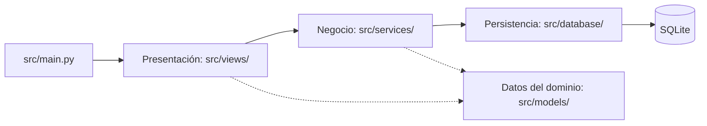
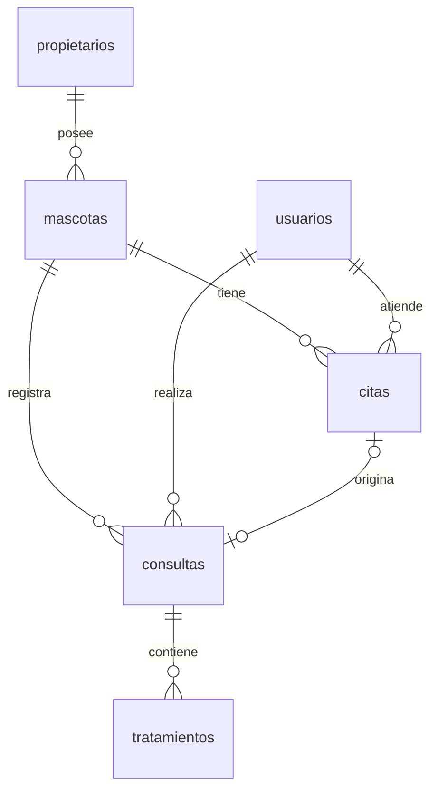

# Gestor De Veterinaria

## 1. Presentación del proyecto

**Gestor De Veterinaria** es una aplicación de escritorio desarrollada en Python para organizar procesos básicos de una clínica veterinaria: propietarios, mascotas, citas, consultas médicas, tratamientos e historiales.

El proyecto se desarrolla en el contexto académico de la asignatura **Entornos de Desarrollo de Software**. Su objetivo es construir un sistema que centralice la información administrativa y clínica, aplicando conocimientos de análisis, diseño, implementación, control de versiones, pruebas y automatización del desarrollo.

Este README documenta la implementación revisada en la rama `develop`. La aplicación tiene alcance académico; su utilización en un entorno clínico profesional requeriría evaluaciones adicionales.

## 2. Problema que resuelve

Una clínica veterinaria puede necesitar coordinar información que se encuentra dispersa en formularios físicos, hojas de cálculo o registros independientes. Esto dificulta relacionar a cada propietario con sus mascotas, organizar citas y recuperar antecedentes durante una atención.

El sistema propone centralizar esos datos y conectar la programación de citas con el registro de síntomas, diagnósticos, observaciones y tratamientos. Así permite consultar los antecedentes de una mascota desde una misma aplicación. Este planteamiento describe una necesidad de gestión; no implica que el software esté siendo utilizado por una clínica real.

## 3. Usuarios y roles

Existen dos roles: **ADMINISTRADOR**, encargado de las cuentas y la información administrativa, y **VETERINARIO**, encargado de registrar la atención clínica y consultar antecedentes.

La siguiente tabla se basa en [permisos.py](src/services/permisos.py). Las condiciones adicionales de agenda y responsabilidad clínica se aplican en los servicios correspondientes.

| Operación | ADMINISTRADOR | VETERINARIO | Permiso |
| --- | --- | --- | --- |
| Administrar usuarios | Sí | No | `gestionar_usuarios` |
| Registrar y modificar propietarios | Sí | No | `gestionar_propietarios` |
| Consultar propietarios | Sí | Sí | `consultar_propietarios` |
| Registrar y modificar mascotas | Sí | No | `gestionar_mascotas` |
| Consultar mascotas | Sí | Sí | `consultar_mascotas` |
| Programar, modificar y cambiar estados de citas | Sí | No | `gestionar_citas` |
| Consultar citas | Todas las agendas | Solo su propia agenda | `consultar_citas` |
| Registrar consultas médicas | No | Sí, con su identidad de sesión | `registrar_consultas` |
| Consultar consultas médicas | Sí | Sí | `consultar_consultas` |
| Registrar tratamientos | No | Solo en consultas de las que es responsable | `registrar_tratamientos` |
| Consultar tratamientos | Sí | Sí | `consultar_tratamientos` |
| Consultar historiales médicos | Sí | Sí | `consultar_historial` |
| Usar la pantalla de pruebas del prototipo | Sí | No | `usar_pruebas` |

La consulta de información clínica no está limitada al veterinario que la registró. La restricción a la propia agenda corresponde al módulo de citas; el registro de tratamientos sí exige ser el veterinario responsable de la consulta. El administrador puede leer la información clínica, pero no registrar consultas ni tratamientos.

## 4. Funcionalidades principales

| Módulo | Funciones implementadas |
| --- | --- |
| Autenticación y usuarios | Configuración del primer administrador, inicio y cierre de sesión; creación y modificación de cuentas, asignación de roles, activación, desactivación y cambio de contraseñas. Se protege al último administrador activo. |
| Propietarios | Registro, edición, búsqueda por nombre o documento y consulta de datos de contacto y mascotas asociadas. |
| Mascotas | Registro y edición de datos, asociación con un propietario existente, búsquedas y filtro por propietario. |
| Citas | Programación, edición, confirmación, cancelación y cambios de estado permitidos; filtros y prevención de superposiciones de citas programadas o confirmadas para un mismo veterinario. |
| Consultas médicas | Registro de fecha, hora, síntomas y, opcionalmente, peso, diagnóstico y observaciones; consulta de detalles y filtros por mascota, fecha y veterinario. |
| Tratamientos | Registro y consulta de descripción y, opcionalmente, medicamento, dosis y duración, siempre dentro de una consulta médica. Se accede desde el detalle de la consulta. |
| Historial médico | Búsqueda de una mascota y lectura de sus consultas, con las más recientes primero, sus detalles clínicos y tratamientos asociados. |

El flujo habitual es:

**Propietario → Mascota → Cita → Consulta médica → Tratamiento → Historial médico.**

La cita es opcional: una consulta médica puede registrarse sin programación previa. Cuando se vincula a una cita, ambas deben corresponder a la misma mascota y al veterinario autenticado; la cita admite como máximo una consulta y pasa a `COMPLETADA` en la misma transacción. Cada consulta puede tener varios tratamientos o ninguno.

Las consultas y los tratamientos se registran y se consultan; la aplicación no ofrece su edición ni eliminación. El historial es una vista de lectura construida con esos registros.

## 5. Requerimientos funcionales y no funcionales

### Requerimientos funcionales

Se conserva la numeración del borrador local de requisitos del proyecto, ajustando su descripción a los permisos y operaciones implementados. Ese borrador no está publicado en el repositorio.

| Código | Requerimiento respaldado por la implementación |
| --- | --- |
| RF-1 | Permitir iniciar y cerrar sesión con una cuenta activa. |
| RF-2 | Permitir al administrador registrar, modificar y desactivar usuarios; también reactivarlos y cambiar sus contraseñas. |
| RF-3 y RF-4 | Registrar, modificar y consultar propietarios, distinguiendo los permisos de gestión y lectura. |
| RF-5 y RF-6 | Registrar mascotas asociadas a propietarios existentes, modificar sus datos y consultar su información. |
| RF-7 y RF-8 | Permitir al administrador programar, modificar y cancelar citas, respetando las transiciones de estado. |
| RF-9 | Evitar superposiciones entre citas programadas o confirmadas de un mismo veterinario. |
| RF-10 | Permitir al veterinario consultar su propia agenda. |
| RF-11 y RF-12 | Permitir al veterinario registrar consultas con síntomas y diagnóstico opcional, con o sin cita previa. |
| RF-13 | Permitir al veterinario responsable registrar tratamientos vinculados a sus consultas. |
| RF-14 | Permitir a ambos roles consultar el historial médico de una mascota. |

**RF-15, generación de reportes básicos, pertenece al planteamiento inicial y no está implementado.** Se mantiene como mejora futura, fuera del alcance funcional actual.

### Requerimientos no funcionales

| Código o aspecto | Soporte actual y alcance |
| --- | --- |
| RNF-1: interfaz comprensible | Formularios, tablas, filtros, calendarios y mensajes de validación en Tkinter/ttk. La facilidad de uso requiere evaluación con usuarios. |
| RNF-2: protección de contraseñas | Hash PBKDF2-HMAC-SHA256 con sal aleatoria y comparación mediante `hmac.compare_digest`; no se guardan contraseñas en texto plano. |
| RNF-3: autorización | Los servicios comprueban permisos y revalidan en SQLite el rol y el estado activo de la cuenta. |
| RNF-4: entorno de ejecución | Docker define la base Ubuntu y las dependencias de ejecución; Compose configura pantalla y almacenamiento. Las versiones de paquetes no están fijadas individualmente. |
| RNF-5: persistencia | SQLite conserva la información en disco; el volumen de Compose permite mantenerla al detener o recrear el contenedor. |
| RNF-6: mantenibilidad | Separación entre vistas, servicios, repositorios y modelos, con pruebas locales y comprobaciones automatizadas de integración. |
| RNF-7: integridad | Claves foráneas, restricciones, índices, triggers y transacciones protegen las relaciones y permiten revertir operaciones fallidas. |
| RNF-8: ejecución gráfica | Tkinter requiere acceso a una pantalla; el entorno documentado utiliza Windows, Ubuntu en WSL2 y WSLg. |
| Validación de entradas | Se comprueban campos obligatorios, identificadores, formatos de fechas y horas, correo opcional, peso positivo y duración de citas, según el módulo. Las consultas SQL utilizan parámetros. |

No se establecen cifras de rendimiento, disponibilidad ni capacidad concurrente que no hayan sido medidas.

## 6. Tecnologías utilizadas

| Tecnología | Propósito dentro del proyecto |
| --- | --- |
| Python | Lenguaje principal para la interfaz, reglas del negocio y acceso a datos. El workflow utiliza Python 3.12. |
| Tkinter y ttk | Ventanas, formularios, tablas y demás componentes de la aplicación de escritorio. |
| tkcalendar | Selección de fechas mediante calendarios. El componente de fechas también utiliza datos de localización de Babel, dependencia de tkcalendar. |
| SQLite y `sqlite3` | Base de datos relacional en un archivo y acceso desde la biblioteca estándar de Python. |
| Docker | Construcción y ejecución de la imagen basada en Ubuntu 24.04 con Python y dependencias gráficas. |
| Docker Compose | Configuración del servicio, variable `DISPLAY`, socket X11 y volumen de datos. |
| Docker Desktop, WSL2, Ubuntu y WSLg | Entorno previsto en Windows para ejecutar contenedores Linux y mostrar la interfaz gráfica. |
| Git | Historial de cambios y trabajo mediante ramas. |
| GitHub | Alojamiento del repositorio, Pull Requests y revisión de integraciones. |
| GitHub Actions | Ejecución del workflow de integración continua. |
| unittest | Pruebas automatizadas locales de servicios, persistencia, permisos e interfaz. |
| Visual Studio Code y Codex | Entorno de desarrollo y asistencia durante el trabajo con el código; no son dependencias de ejecución. |

## 7. Arquitectura del sistema

La aplicación utiliza una **arquitectura por capas**, con modelos que representan los datos del dominio. No se plantea como un MVC estricto.

| Componente | Ubicación | Responsabilidad |
| --- | --- | --- |
| Presentación | [src/views/](src/views/) | Mostrar formularios y resultados, capturar entradas y comunicar acciones mediante callbacks. |
| Lógica de negocio | [src/services/](src/services/) | Autenticar, autorizar, validar y coordinar las operaciones del sistema. |
| Persistencia | [src/database/](src/database/) | Abrir conexiones, inicializar el esquema y ejecutar consultas SQL a través de repositorios. |
| Modelos | [src/models/](src/models/) | Representar usuarios, propietarios, mascotas, citas, consultas, tratamientos e historiales mediante dataclasses. |

[src/main.py](src/main.py) inicializa la base de datos y crea la ventana principal. `Aplicacion`, en `src/views/aplicacion.py`, coordina la navegación y comparte la sesión con los servicios. Los servicios utilizan repositorios para acceder a SQLite y devuelven modelos o resultados que las vistas presentan al usuario.



## 8. Base de datos SQLite

SQLite permite almacenar datos relacionales sin administrar un servidor de base de datos independiente, lo que resulta adecuado para el alcance de este prototipo de escritorio. Python se conecta mediante `sqlite3` en [connection.py](src/database/connection.py).

El archivo configurado actualmente se llama **`data/GestorDeVeterinaria.db`**. Dentro del contenedor corresponde a **`/app/data/GestorDeVeterinaria.db`**. Esta ruta está definida por `DB_PATH` en `connection.py`.

### Tablas y relaciones

El esquema real está definido en [schema.py](src/database/schema.py).

| Tabla | Datos principales y relaciones |
| --- | --- |
| `usuarios` | Nombre, nombre de usuario único, hash, rol y estado activo. Los usuarios con rol veterinario pueden estar vinculados a citas y consultas. |
| `propietarios` | Nombre, documento único y datos de contacto. Un propietario puede tener varias mascotas. |
| `mascotas` | Datos de identificación y un propietario obligatorio. Una mascota puede tener varias citas y consultas. |
| `citas` | Mascota, veterinario, fecha y hora de inicio, duración, motivo y estado. |
| `consultas` | Mascota, veterinario, fecha y hora, síntomas, peso, diagnóstico y observaciones; referencia opcional y única a una cita. |
| `tratamientos` | Consulta obligatoria, descripción, medicamento, dosis y duración. |



Las relaciones desde `usuarios` hacia citas y consultas corresponden exclusivamente al rol `VETERINARIO`. Cada consulta puede tener cero o una cita, y cada cita cero o una consulta.

### Integridad, transacciones e historial

Cada conexión activa `PRAGMA foreign_keys = ON` y `PRAGMA recursive_triggers = ON`. El esquema utiliza `NOT NULL`, `UNIQUE`, `CHECK` y referencias con `ON DELETE RESTRICT` y `ON UPDATE RESTRICT`. Los triggers verifican el rol veterinario, la correspondencia de mascota y veterinario entre cita y consulta, y bloquean la eliminación de consultas y tratamientos.

Los repositorios utilizan transacciones; las operaciones de escritura coordinadas emplean `BEGIN IMMEDIATE`. La conexión confirma los cambios cuando la operación finaliza correctamente y los revierte si ocurre una excepción. La inicialización crea tablas, índices y triggers si no existen, conservando los datos existentes.

El historial no tiene una tabla independiente: combina la mascota, sus consultas y los tratamientos de cada consulta. Su lectura se realiza en una misma transacción con `PRAGMA query_only = ON`, sin modificar los registros clínicos.

También existe la tabla `pruebas`, utilizada por una pantalla del prototipo para insertar y contar registros de comprobación de persistencia. Esa pantalla no ejecuta las pruebas automatizadas de `unittest`.

### Persistencia con Docker

[compose.yaml](compose.yaml) monta el volumen nombrado `gestordeveterinaria_data` en `/app/data`. El volumen conserva la base al detener o recrear el contenedor. Compose puede añadir el nombre del proyecto como prefijo al nombre efectivo del volumen; cambiar de proyecto puede hacer que se utilice otro volumen.

La carpeta `data/` del repositorio no es un montaje del contenedor: una ejecución directa de Python usa el archivo local, mientras que Compose utiliza el archivo del volumen.

## 9. Estructura del repositorio

Árbol representativo de los archivos publicados y del directorio de pruebas local:

```text
GestorDeVeterinaria/
├── .github/
│   └── workflows/
│       └── ci.yml
├── docs/
│   ├── analisis/
│   │   └── .gitkeep
│   ├── arquitectura/
│   │   └── .gitkeep
│   └── diagramas/
│       ├── DiagramaCasosDeUso.png
│       ├── DiagramaDeClases.png
│       └── DiagramaDeSecuencia.jpg
├── src/
│   ├── database/
│   │   ├── connection.py
│   │   ├── initialization.py
│   │   ├── schema.py
│   │   └── ...
│   ├── models/
│   ├── services/
│   ├── views/
│   └── main.py
├── tests/
│   ├── .gitkeep
│   └── ... (archivos de pruebas disponibles solo localmente)
├── .gitignore
├── Dockerfile
├── compose.yaml
└── README.md
```

`.github/workflows/` contiene la automatización de CI. `docs/diagramas/` conserva los UML; `docs/analisis/` y `docs/arquitectura/` solo contienen marcadores `.gitkeep` publicados. Las carpetas de `src/` corresponden a las responsabilidades descritas en la arquitectura. En `tests/` solo se publica `.gitkeep`: los archivos de pruebas permanecen locales por decisión del desarrollador. Existen además borradores locales de documentación que no forman parte del contenido publicado.

## 10. Instalación y ejecución

### Requisitos previos

Para el entorno previsto en Windows se requiere:

1. Docker Desktop instalado y en ejecución, configurado para contenedores Linux con WSL2.
2. Ubuntu instalado como distribución WSL2 y habilitado en la integración de Docker Desktop.
3. WSLg disponible y operativo para mostrar aplicaciones Linux gráficas.
4. Git instalado en Ubuntu y acceso a Internet para clonar el repositorio y construir la imagen.

Los siguientes comandos se ejecutan en una terminal de **Ubuntu dentro de WSL2**, desde una sesión con acceso a pantalla. No es necesario instalar Python en Windows para ejecutar la aplicación con Docker.

### Clonar y entrar al proyecto

La versión documentada se encuentra en `develop`:

```bash
git clone --branch develop https://github.com/FRJohan312/GestorDeVeterinaria.git
cd GestorDeVeterinaria
```

### Comprobar Docker y el entorno gráfico

```bash
docker --version
docker compose version
echo $DISPLAY
ls /tmp/.X11-unix
```

`DISPLAY` debe apuntar a la pantalla de la sesión WSLg, habitualmente `:0`, y el directorio X11 debe ofrecer el socket correspondiente. Un valor no vacío de `DISPLAY` por sí solo no garantiza acceso gráfico.

Compose transmite `DISPLAY` al contenedor, usando `:0` como valor por defecto si no está definida, y monta `/tmp/.X11-unix`. Si la variable está vacía, falta el socket o aparece un error como `couldn't connect to display`, compruebe primero que WSLg funciona y que Docker Desktop está integrado con esa distribución.

Tkinter necesita un servidor gráfico y acceso efectivo a la pantalla. La configuración actual utiliza el servidor X11 de WSLg; iniciar el contenedor desde el botón Play de Docker Desktop no configura por sí solo ese acceso.

### Construir y ejecutar

Desde la raíz del proyecto:

```bash
docker compose up --build
```

[Dockerfile](Dockerfile) instala `python3`, `python3-tk` y `tkcalendar` sobre Ubuntu 24.04, copia `src/` a la imagen y ejecuta `python3 src/main.py`.

En el primer inicio, si la base no contiene usuarios, se solicita crear el primer administrador. La contraseña debe tener al menos ocho caracteres y coincidir con su confirmación. Después se inicia sesión con esa cuenta y se pueden crear los usuarios veterinarios desde el módulo Usuarios. No hay credenciales predeterminadas.

### Detener y conservar los datos

Cierre la ventana o presione `Ctrl+C` en la terminal donde se ejecuta Compose. Para retirar el contenedor y la red del proyecto:

```bash
docker compose down
```

Este comando conserva el volumen de datos. Para volver a iniciar, ejecute `docker compose up --build` desde el mismo proyecto.

**Advertencia:** `docker compose down -v` elimina el volumen persistente del proyecto y puede provocar la pérdida de los usuarios y registros almacenados. La persistencia del volumen no sustituye una copia de seguridad.

## 11. Estrategia de ramas Git

La estrategia de trabajo distingue:

| Rama | Propósito |
| --- | --- |
| `main` | Destino de las versiones consideradas estables. |
| `develop` | Integración de funcionalidades antes de preparar una versión estable. |
| `feature/*` | Desarrollo de funcionalidades independientes a partir de `develop`. |

El flujo es **Crear rama → Desarrollar → Probar → Commit → Push → Pull Request → Revisión → Merge**. La promoción de `develop` a `main` debe revisarse por separado; esta descripción no certifica que esté completada ni que un PR concreto esté cerrado.

Ejemplo para un cambio futuro en la validación de citas:

```bash
git switch develop
git pull --ff-only origin develop
git switch -c feature/mejoras-validacion-citas
```

Después de implementar y validar el cambio:

```bash
git diff
git add src/services/citas.py
git commit -m "Valida los datos de programación de citas"
git push -u origin feature/mejoras-validacion-citas
```

Las rutas añadidas al commit deben corresponder a los archivos realmente modificados. La publicación de las pruebas locales y de los borradores de documentación es una decisión separada del desarrollador.

## 12. Flujo de desarrollo

1. **Desarrollar una funcionalidad.** Definir su requisito, rol autorizado y criterios de aceptación; crear una rama `feature/*` desde `develop`. Implementar las reglas en servicios, el SQL en repositorios y la interacción en vistas, incorporando modelos cuando corresponda.
2. **Probar y documentar los commits.** Revisar el diff, ejecutar las comprobaciones disponibles y verificar el flujo afectado. Crear commits centrados en un cambio, con mensajes que describan su propósito. El historial local contiene ejemplos como `Gestión de mascotas`, `Gestion de tratamientos veterinarios` e `Historial medico de mascotas`.
3. **Crear el Pull Request.** Publicar la rama y abrir un PR en GitHub con base `develop` y comparación `feature/*`. Explicar el problema, comportamiento resultante, archivos relevantes y validaciones realizadas, incluyendo las limitaciones de pruebas o del entorno.
4. **Revisar y realizar el merge.** Revisar código, permisos, relaciones de datos y resultados de Actions; corregir observaciones en la misma rama. Cuando la revisión y las comprobaciones sean satisfactorias, utilizar la opción de merge del PR. El historial local registra integraciones mediante Pull Requests, pero el estado actual de cada uno debe consultarse en GitHub.
5. **Validar la integración.** Actualizar `develop`, comprobar el workflow disparado por el push resultante y repetir la verificación funcional afectada. Conservar resultados de pruebas y evidencias de revisión para la entrega académica.

Tras integrar el PR, la copia local puede actualizarse con:

```bash
git switch develop
git pull --ff-only origin develop
git log --oneline -n 10
```

Estos comandos describen el procedimiento; no implican que el README o los cambios locales hayan sido publicados.

## 13. Pruebas del sistema

Las pruebas automatizadas locales utilizan **unittest**, de la biblioteca estándar de Python. Comprueban autenticación, permisos por rol, validaciones, persistencia, transacciones y restricciones SQLite; también conflictos y estados de citas, relaciones entre cita y consulta, responsabilidad sobre tratamientos e historial de solo lectura.

Existen pruebas de integración y de interfaz Tkinter que utilizan bases temporales. Las pruebas gráficas necesitan Tkinter, tkcalendar y una pantalla accesible; según la clase, pueden omitirse cuando no se cumple alguna de esas condiciones. Una ejecución con omisiones no valida todos los recorridos de interfaz.

Desde la raíz del proyecto, **únicamente si se dispone de los archivos locales de pruebas** y de las dependencias necesarias:

```bash
PYTHONPATH=src python3 -m unittest discover -s tests -t . -v
```

Por decisión del desarrollador, los archivos de `tests/` no se publican actualmente; solo está versionado su marcador `.gitkeep`. Clonar el repositorio no proporciona esa suite y ejecutar el comando sin ella no constituye evidencia de validación. Tampoco se copia `tests/` a la imagen mediante el Dockerfile actual.

Los resultados deben registrarse al ejecutar la suite, indicando entorno, fallos y omisiones. No se fija aquí una cantidad de pruebas aprobadas. La pantalla **Pruebas del prototipo** únicamente comprueba inserción y conteo en SQLite y es independiente de `unittest`.

## 14. Integración continua y CI/CD

La **integración continua (CI)** ejecuta comprobaciones automáticas sobre cambios enviados al repositorio para detectar problemas antes de integrarlos y después de su incorporación. La configuración implementada se encuentra en [.github/workflows/ci.yml](.github/workflows/ci.yml), bajo el nombre **Calidad y empaquetado**.

### Eventos y entorno

El workflow se ejecuta en:

- `push` a `develop` o `main`.
- `pull_request` cuya rama de destino sea `develop` o `main`.

Un push a una rama `feature/*` sin PR no coincide por sí solo con el filtro de push. El trabajo `validar`, **Python y Docker sin interfaz gráfica**, utiliza `ubuntu-24.04`, Python `3.12` y un tiempo máximo de 15 minutos. Solicita permiso de lectura del contenido del repositorio.

### Comprobaciones configuradas

| Paso | Qué comprueba |
| --- | --- |
| Preparación | Descarga el repositorio y configura Python. |
| Sintaxis | Ejecuta `python -m compileall -q src`. |
| Importaciones y SQLite temporal | Importa los módulos de modelos, persistencia y servicios; inicializa una base temporal dos veces y comprueba tablas, conservación de un registro de prueba, claves foráneas, integridad y necesidad de configuración inicial sin usuarios. |
| Construcción Docker | Ejecuta `docker build --tag gestordeveterinaria:ci .`. |
| Dependencias gráficas | Ejecuta un contenedor temporal sin red, con `/app/data` en memoria; importa Tkinter, tkcalendar, las vistas y `main`, sin crear ventanas ni iniciar el bucle gráfico. |

Estas comprobaciones ayudan a detectar errores de sintaxis, importación, esquema y empaquetado. No sustituyen las pruebas funcionales ni confirman que una ventana pueda mostrarse en WSLg. El workflow **no ejecuta unittest** ni utiliza la base de datos real.

Para consultar resultados, abra la pestaña [Actions del repositorio](https://github.com/FRJohan312/GestorDeVeterinaria/actions), seleccione **Calidad y empaquetado**, elija la ejecución y revise los registros de cada paso. En un PR también pueden consultarse las comprobaciones asociadas al cambio.

En términos de **CI/CD**, el proyecto implementa CI. Una futura entrega continua podría preparar un artefacto distribuible, y un despliegue continuo requeriría automatizar su instalación o publicación. El workflow actual construye y comprueba una imagen, pero no la publica ni despliega automáticamente la aplicación.

## 15. Diagramas UML

Los diagramas publicados se encuentran en [docs/diagramas/](docs/diagramas/):

| Diagrama | Archivo | Alcance y limitaciones |
| --- | --- | --- |
| Casos de uso | [DiagramaCasosDeUso.png](docs/diagramas/DiagramaCasosDeUso.png) | Conserva elementos del planteamiento inicial, como reportes, la denominación Administrador/Recepcionista y asociaciones de permisos que difieren de los servicios actuales. |
| Clases | [DiagramaDeClases.png](docs/diagramas/DiagramaDeClases.png) | Representa las entidades principales, pero sitúa operaciones dentro de modelos que actualmente son dataclasses; incluye actualización de tratamientos, que no está implementada, y atributos de cita anteriores al esquema actual. |
| Secuencia | [DiagramaDeSecuencia.jpg](docs/diagramas/DiagramaDeSecuencia.jpg) | Ilustra la programación de una cita y el caso de horario ocupado. Es una secuencia simplificada; no detalla todos los controles de sesión ni la transacción de la implementación. |

Estos archivos sirven como antecedentes de diseño y no se presentan como documentación completamente actualizada. La tabla de permisos, la descripción por capas y el esquema de datos de este README reflejan el código revisado. Las imágenes requieren una revisión separada para alinearlas con esa implementación.

## 16. Estado del proyecto y mejoras futuras

La versión revisada incluye autenticación, administración de usuarios, propietarios y mascotas, gestión de citas, registro de consultas con diagnósticos y observaciones, tratamientos vinculados e historial médico de lectura. También dispone de ejecución mediante Docker/Compose y un workflow de CI. Las pruebas automatizadas se mantienen localmente.

Las siguientes posibilidades permanecen como **mejoras futuras**:

- Reportes administrativos, correspondientes al requisito inicial RF-15.
- Exportación de historiales médicos.
- Mejoras adicionales de interfaz y evaluación de usabilidad.
- Distribución de una versión instalable.
- Actualización de UML y consolidación de documentos de análisis y arquitectura.

Para completar las evidencias académicas conviene preparar por separado la especificación detallada de requisitos y criterios de aceptación, la justificación de diseño, los UML corregidos, el informe de pruebas con sus omisiones y los registros de commits, revisión de PR y ejecuciones de Actions. Las carpetas reservadas para análisis y arquitectura todavía no contienen esos documentos publicados.

## 17. Conclusión

Gestor De Veterinaria permite aplicar la organización de un proyecto y la arquitectura por capas a un problema de gestión concreto. El trabajo con Git, ramas y Pull Requests aporta trazabilidad; las pruebas y la automatización de CI apoyan la detección de errores. La experiencia también muestra la importancia de mantener requisitos, diagramas, código y evidencias de calidad alineados durante el desarrollo.
